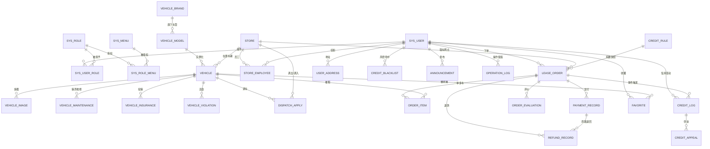

# 02 数据库设计（30 张表 · v1.0）

> MySQL 8.0 / InnoDB / utf8mb4_general_ci / 库名 `zuche`
> 建表脚本：`sql/01-schema.sql`（含必要初始数据）；演示数据：`sql/02-seed.sql`

---

## 一、设计约定

| 项 | 约定 |
|---|---|
| 主键 | `id BIGINT UNSIGNED AUTO_INCREMENT` |
| 金额 | `DECIMAL(10,2)`，Java 侧 `BigDecimal`，禁止 double |
| 时间 | `DATETIME`（`DATE` 用于租期/保险期等纯日期） |
| 审计字段 | 全部表含 `create_time` / `update_time`；业务实体表另有 `deleted`（0 正常 1 删除） |
| 流水类表 | `payment_record` / `refund_record` / `credit_log` / `operation_log` / `order_item` 不设 `deleted`：记账与流水数据不可删除，只能反向冲正 |
| 外键 | 逻辑外键 + 索引，不建物理外键（与 MyBatis-Plus 逻辑删除、批量初始化冲突，完整性由 Service 保证） |
| 枚举 | 状态码存 `VARCHAR`（可读、便于答辩讲解），字典表 `sys_dict_data` 提供中文标签与颜色 |
| 信用分 | `sys_user.credit_score = clamp(100 + Σ credit_log.score_change, 0, 150)` |

---

## 二、ER 关系总览



**主干一句话**：`用户 1—N 订单 N—N 车辆（经 order_item）N—1 网点`；`订单 1—N 支付 1—N 退款`；`用户 1—N 信用日志 N—1 订单`；`品牌 1—N 车型 1—N 车辆`。

与旧版（18 表）的差异：拆分品牌/车型/车辆三级资产模型，订单支持一单多车，支付与退款分离，新增菜单/字典/申诉/黑名单/资产台账，共 30 表。

---

## 三、模块一：系统权限与基础配置（6 张）

| # | 表 | 作用 | 关键字段 | 关系 |
|---|---|---|---|---|
| 1 | `sys_user` | 三类角色共用账号，普通用户持有信用分 | `username`(UK)、`password`(BCrypt)、`credit_score`、`credit_level`、`store_id`、`status` | N—N `sys_role` |
| 2 | `sys_role` | 角色字典（USER / STORE_ADMIN / SYS_ADMIN） | `role_code`(UK)、`role_name` | — |
| 3 | `sys_menu` | 菜单与权限点，前端按角色渲染 | `parent_id`、`menu_type`(M/C/F)、`path`、`component`、`perms` | N—N `sys_role` |
| 4 | `sys_user_role` | 用户-角色关联 | `user_id`、`role_id`（唯一） | 关联表 |
| 5 | `sys_role_menu` | 角色-菜单关联 | `role_id`、`menu_id`（唯一） | 关联表 |
| 6 | `sys_dict_data` | 数据字典：订单状态、车型分类、变速箱、能源、支付方式、申诉/调度/违章状态 | `dict_type` + `dict_code`（联合唯一）、`dict_label`、`dict_value`(颜色) | 被各表状态字段引用 |

> RBAC 落地方式：菜单表给前端渲染，`perms` 给后端 `@RequireRole` / 权限点使用；角色固定 3 个，不做按钮级动态授权界面（答辩说明"按钮级权限对本系统无业务增量"）。

---

## 四、模块二：车辆资产精细化管理（7 张）

资产模型是**三级**的，这是本模块的设计核心：

```
vehicle_brand（品牌，营销维度）
   └─ vehicle_model（车型：参数 + 指导价 + 标准押金，展示与定价维度）
        └─ vehicle（具体一台车：车牌/VIN/所属网点/里程/状态，可租与调度维度）
```

| # | 表 | 作用 | 关键字段 | 关系 |
|---|---|---|---|---|
| 7 | `vehicle` | 最小可租单元，一台车一条记录 | `vehicle_no`(UK)、`model_id`、`brand_id`(冗余)、`store_id`、`license_plate`(UK)、`vin`、`current_mileage`、`daily_price`、`deposit`、`discount_rate`、`status`(1可租 2已租出 3维修中 0下架)、`rent_count` | N—1 `vehicle_model`、`store` |
| 8 | `vehicle_brand` | 品牌，用于筛选与品牌墙 | `brand_name`(UK)、`initial` | 1—N `vehicle_model` |
| 9 | `vehicle_model` | 车型参数与标准价 | `brand_id`、`model_name`、`category_code`(字典)、`seats`、`gearbox`、`fuel_type`、`guide_price`、`deposit` | N—1 `vehicle_brand` |
| 10 | `vehicle_image` | 车辆多图，按 `sort_no` 第一张为主图 | `vehicle_id`、`image_url`、`image_type`(外观/内饰/证件) | N—1 `vehicle` |
| 11 | `vehicle_maintenance` | 保养维修台账，维修中车辆自动下架 | `maint_type`、`maint_date`、`mileage`、`cost`、`next_date`(到期提醒) | N—1 `vehicle` |
| 12 | `vehicle_insurance` | 保险台账，保险过期不允许上架 | `insurance_type`(交强/商业)、`policy_no`、`start_date`、`end_date`、`premium` | N—1 `vehicle` |
| 13 | `vehicle_violation` | 违章台账，可关联订单定位责任人 | `order_id`、`user_id`、`violation_time`、`fine_amount`、`points`、`handle_status` | N—1 `vehicle` |

> 为什么不用"库存数字"：一辆车有唯一车牌与保险/保养/违章记录，用 `stock` 计数无法回答"哪台车该保养了""这条违章算谁的"。因此库存 = 该网点 `status=1` 的车辆数。

---

## 五、模块三：网点与调度管理（3 张）

| # | 表 | 作用 | 关键字段 |
|---|---|---|---|
| 14 | `store` | 多网点，支持异地还车 | `store_code`(UK)、`address`、`business_hours`、`manager_id`、经纬度（**仅存储，不做地图渲染**）；**不冗余 `vehicle_count`**，车辆数统一 `COUNT(vehicle)` 实时统计，避免调车后不一致 |
| 15 | `store_employee` | 网点员工/管理员，权限按网点隔离 | `store_id` + `user_id`(唯一)、`position`、`entry_date` |
| 16 | `dispatch_apply` | 跨网点调车申请与审批留痕 | `apply_no`(UK)、`vehicle_id`、`from_store_id`、`to_store_id`、`status`(PENDING/APPROVED/REJECTED/CANCELLED)、`audit_user_id`、`audit_remark` |

调车规则：同一车辆不允许同时存在多条 `PENDING`；审批通过时在同一事务内更新 `vehicle.store_id` 并写 `operation_log`。

---

## 六、模块四：租赁订单与交易（6 张）

| # | 表 | 作用 | 关键字段 |
|---|---|---|---|
| 17 | `lease_order` | 订单主表，承载信用快照与状态机 | `order_no`(UK)、`user_id`、`store_id`、`start_date/end_date/rent_days`、`vehicle_count`、`rent_amount/deposit_amount/total_amount`、`credit_score_snapshot`、`credit_level_snapshot`、`deposit_coefficient`、`status`、`overdue_days`、`late_fee`、`deposit_refund_status` |
| 18 | `order_item` | 一单多车明细，下单时快照车名/车牌/日租金 | `order_id`、`vehicle_id`、`vehicle_name`、`license_plate`、`daily_price`、`quantity`、`rent_amount`、`deposit_amount` |
| 19 | `payment_record` | 模拟支付流水；营收口径只算 `RENT` | `pay_no`(UK)、`pay_type`(RENT/DEPOSIT/LATE_FEE)、`amount`、`pay_method`(MOCK_*)、`status`、`pay_time` |
| 20 | `refund_record` | 退款流水：押金退还/取消退款/违约金冲正 | `refund_no`(UK)、`payment_id`、`refund_type`、`amount`、`status`(PENDING/REFUNDED/FAILED)、`apply_time`、`refund_time` |
| 21 | `order_evaluation` | 一单一评，仅已完成订单可评 | `order_id`(UK)、`rating`、`content`、`reply`、`status` |
| 22 | `user_address` | 合同/发票寄送地址 | `receiver`、`phone`、省市区、`detail`、`is_default` |

**金额口径（答辩必问）**：
```
rentAmount(item)     = daily_price × rent_days × quantity × discount_rate
depositAmount(item)  = vehicle.deposit × credit_rule(当前等级).deposit_coefficient × quantity
order.rent_amount    = Σ item.rent_amount
order.deposit_amount = Σ item.deposit_amount
order.total_amount   = rent_amount + deposit_amount
```

> `vehicle` 一行就是一台带唯一车牌的实体车，因此 S2 单车下单入口中 `quantity` 恒为 1；
> 字段保留是为后续「按车型批量下单」预留（那时需按 `model_id` 选出 N 台不同车辆，拆成 N 行明细）。
> 押金按台数累计：租 2 台同款车，押金就是单台的 2 倍，这样才和真实租赁一致。
支付时生成两条 `payment_record`（RENT、DEPOSIT）；完成订单生成一条 `refund_record`（DEPOSIT）。营收统计只取 `pay_type='RENT'`，押金减免才能被单独度量。

**订单状态机**：

| 状态 | 含义 | 允许流转到 | 触发方 |
|---|---|---|---|
| `WAIT_PAY` | 待支付 | `WAIT_PICKUP`、`CANCELLED` | 用户 |
| `WAIT_PICKUP` | 待取车 | `IN_USE`、`CANCELLED` | 用户/网点 |
| `IN_USE` | 已取车/在租 | `WAIT_RETURN`、`OVERDUE` | 用户/定时任务 |
| `WAIT_RETURN` | 待归还 | `RETURNED` | 网点 |
| `OVERDUE` | 逾期 | `WAIT_RETURN`、`RETURNED` | 用户/网点 |
| `RETURNED` | 已归还 | `COMPLETED` | 网点 |
| `COMPLETED` | 已完成 | — 终态 | — |
| `CANCELLED` | 已取消 | — 终态 | — |

> **枚举允许 ≠ 当前阶段开放**：`WAIT_PICKUP → CANCELLED` 是业务上合法的流转（已支付未取车可取消），
> 但它必须同时产生「退款流水 + 信用扣分」。S2 只实现了未支付取消，因此 `OrderService.cancel()`
> 里额外用 `assertStatus(current, WAIT_PAY)` 把入口收窄；等 S3 接入退款与扣分后再放开。
> 这就是"状态机管合法性、服务层管当前阶段策略"的分工——只写状态机是不够的。

---

## 七、模块五：信用风控（4 张，核心特色）

| # | 表 | 作用 | 关键字段 |
|---|---|---|---|
| 23 | `credit_rule` | 等级阈值 + 押金系数 + 行为加减分，全部可后台改 | `rule_type`(LEVEL/ACTION)、`rule_code`、`min_score`、`max_score`、`deposit_coefficient`、`score_value`、`max_times` |
| 24 | `credit_log` | 信用变动流水，分数可复算 | `action_code`、`change_type`(EVENT/ADMIN/APPEAL)、`score_before/score_change/score_after`、`order_id`、`dedup_key`、`reason` |
| 25 | `credit_appeal` | 用户对扣分申诉，管理员复核可补分 | `appeal_no`(UK)、`credit_log_id`、`order_id`、`reason`、`status`、`restore_score`、`handle_remark` |
| 26 | `credit_blacklist` | 风控名单：预警/限制下单/黑名单 | `list_type`、`trigger_rule`、`effective_time`、`expire_time`、`status` |

**为什么等级规则和行为规则合成一张表**：两者都是"可配置的业务参数"，字段高度重叠（编码/名称/分值/说明），拆成两张表会产生两套几乎一样的 CRUD；用 `rule_type` 区分后，后台一个页面即可维护，`(rule_type, rule_code)` 联合唯一保证不重复。

**分数自洽（本项目的核心不变量）**：
- `credit_score = clamp(100 + Σ credit_log.score_change, 0, 150)`，任何变动先写日志、同事务更新用户表；
- `credit_log` 唯一索引 `(order_id, action_code, dedup_key)` 保证幂等——定时任务重复扫描不会重复扣分；
- 订单表存 `credit_level_snapshot` + `deposit_coefficient` 快照，用户后续涨分不影响历史订单退款金额。

**默认规则（可改）**：

| 等级 | 分数区间 | 押金系数 |
|---|---|---|
| 优秀 EXCELLENT | 120–150 | 0.80 |
| 良好 GOOD | 100–119 | 0.90 |
| 一般 NORMAL | 80–99 | 1.00 |
| 待观察 WATCH | 0–79 | 1.20 |

| 行为 | 分值 | 生效次数 |
|---|---|---|
| 订单完成 | +2 | 1/单 |
| 按时归还 | +5 | 1/单 |
| 逾期未还 | −3 | 每天，最多 7 次 |
| 逾期后归还 | −5 | 1/单 |
| 取消已支付订单 | −3 | 1/单 |
| 管理员调整 | 手填 | — |

---

## 八、模块六：运营与系统审计（4 张）

| # | 表 | 作用 | 关键字段 |
|---|---|---|---|
| 27 | `announcement` | 公告，前台展示 | `title`、`content`、`type`、`status`、`view_count`、`publish_time` |
| 28 | `banner` | 首页轮播 | `image_url`、`link_url`、`position`、`sort_no` |
| 29 | `favorite` | 收藏 | `user_id` + `vehicle_id`（唯一） |
| 30 | `operation_log` | 后台写操作留痕（AOP 写入） | `module`、`operation`、`method`、`request_uri`、`params`、`ip`、`cost_ms`、`status` |

---

## 九、演示数据规模（`02-seed.sql`）

| 数据 | 数量 | 说明 |
|---|---|---|
| 菜单 / 字典 / 角色菜单 | 39 / 41 / 54 | 支撑三角色菜单渲染与状态翻译 |
| 品牌 / 车型 / 车辆 | 9 / 24 / 24 | 覆盖 5 个分类、4 个网点 |
| 车辆图片 / 保险 / 保养 / 违章 | 72 / 48 / 12 / 7 | 资产台账可演示 |
| 用户 | 9（3 管理员 + 6 普通） | 四档信用等级各有用户 |
| 订单 / 明细 / 支付 / 退款 | 300 / 400 / 540 / 210 | 近 30 天，双峰时段，供热力图与预测 |
| 信用日志 | 20 | 含 5 条校准 + 抽样事件 |
| 评价 / 收藏 / 地址 / 公告 / 轮播 / 调车 / 申诉 / 风控 / 日志 | 12/6/4/4/3/2/3/2/10 | 覆盖各管理页 |

订单状态分布：完成 210、取消 30、在租 30、逾期 15、待取车 15。

---

## 十、一致性自检（已通过，结果均为 0）

```sql
-- 信用分恒等式：应为 0
SELECT COUNT(*) FROM sys_user u
LEFT JOIN (SELECT user_id, SUM(score_change) s FROM credit_log GROUP BY user_id) x ON x.user_id = u.id
WHERE u.credit_score <> LEAST(150, GREATEST(0, 100 + IFNULL(x.s, 0)));

-- 订单金额与明细一致：应为 0
SELECT COUNT(*) FROM lease_order o
JOIN (SELECT order_id, ROUND(SUM(rent_amount),2) r, COUNT(*) c FROM order_item GROUP BY order_id) i
  ON i.order_id = o.id
WHERE o.rent_amount <> i.r OR o.vehicle_count <> i.c;
```
